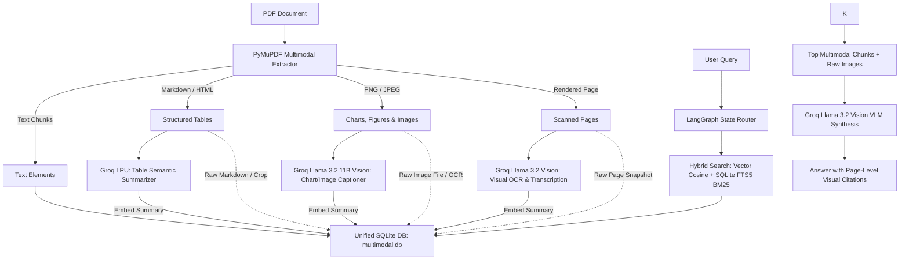

# 📑 Multimodal RAG: Chat with PDFs, Tables, Charts & Images

A production-grade **Multimodal Retrieval-Augmented Generation (RAG)** system built with **Groq Llama 3.2 Vision**, **LangChain**, **LangGraph**, **PyMuPDF**, **FastAPI**, and **Streamlit**.

Unlike basic text-only RAG pipelines that fail on complex enterprise documents, this architecture extracts, parses, enriches, and grounds answers across **text, structured tables, visual charts, embedded diagrams, and scanned pages**.

---

## 🏗️ Architecture Overview



---

## 🚀 Key Features

1. **Dual OCR + Vision-Language Fusion Engine**:
   - Integrates **Tesseract OCR 5.5** to transcribe verbatim raw text, axis numbers, and labels embedded inside charts, diagrams, and scanned pages.
   - Fuses the OCR text directly into **Groq Llama 3.2 11B Vision** prompts as ground-truth context, preventing numerical hallucinations and misread labels.
2. **Layout-Aware PDF Extraction**:
   - Uses PyMuPDF (`fitz`) to detect narrative text blocks, tables, embedded raster images, and vector graphics.
   - Detects scanned / image-only documents and automatically captures high-resolution page snapshots.
3. **Multi-Vector Retriever Pattern**:
   - Decouples **what is searched** (compact text summaries) from **what is provided to the LLM** (original high-resolution image or structured HTML table).
4. **Hybrid Retrieval with Reciprocal Rank Fusion (RRF)**:
   - Combines semantic vector similarity with lexical keyword search.
   - Boosts chunks targeting specific pages (e.g. *"Explain the chart on page 2"*).
5. **Agentic LangGraph Workflow**:
   - Stateful orchestration (`router` $\to$ `retriever` $\to$ `synthesizer`).
   - Dynamically assembles multimodal payloads (base64 image URLs + formatted text context).
6. **Dual Interfaces**:
   - **Interactive Web UI (Streamlit)**: Live PDF drag-and-drop, visual asset gallery, expandable citations, and chat.
   - **REST API (FastAPI)**: Fully typed endpoints (`/api/upload`, `/api/chat`, `/api/documents`) ready for React/Next.js integrations.

---

## 📁 Project Structure

```
d:/multimodal-rag/
├── src/
│   ├── config.py             # Environment variables, directory paths, model constants
│   ├── extractor.py          # PyMuPDF extractor for text, tables, and images
│   ├── summarizer.py         # Groq Vision Llama 3.2 summarizer for images & tables
│   ├── embeddings.py         # Embedding provider (HuggingFace + zero-dep local fallback)
│   ├── store.py              # Multi-Vector dual store (VectorStore + Raw DocStore)
│   ├── retriever.py          # Hybrid retrieval (Vector + Lexical) with RRF & Page filters
│   ├── graph.py              # LangGraph workflow state machine
│   └── pipeline.py           # Coordinator unifying ingestion and query execution
├── api/
│   └── main.py               # FastAPI backend with static image hosting & CORS
├── sample_data/
│   ├── create_sample_pdf.py  # Generates test PDF with text, tables, and charts
│   └── sample_multimodal_report.pdf
├── app.py                    # Streamlit interactive chat UI with visual citations
├── test_pipeline.py          # End-to-end integration test
├── requirements.txt          # Python dependencies
├── .env.example              # Example environment configuration
└── README.md
```

---

## 🛠️ Quickstart & Setup

### 1. Set Your Groq API Key
Obtain a free API key from [Groq Console](https://console.groq.com). Then edit `d:/multimodal-rag/.env`:
```bash
GROQ_API_KEY=gsk_your_actual_key_here
```
*(You can also enter your key directly inside the Streamlit UI sidebar)*

### 2. Generate the Sample Multimodal PDF
```powershell
python d:/multimodal-rag/sample_data/create_sample_pdf.py
```

### 3. Run the Streamlit Web Application
```powershell
streamlit run d:/multimodal-rag/app.py
```
Open `http://localhost:8501` in your browser. Upload any PDF or use the generated `sample_multimodal_report.pdf`.

### 4. (Optional) Run the FastAPI Backend
```powershell
uvicorn api.main:app --app-dir d:/multimodal-rag --reload --port 8000
```
Explore the interactive Swagger API documentation at: `http://localhost:8000/docs`.

---

## 🧪 Running the Verification Test
```powershell
python d:/multimodal-rag/test_pipeline.py
```
This verifies layout extraction, image slicing, catalog creation, multi-vector indexing, and hybrid retrieval.
